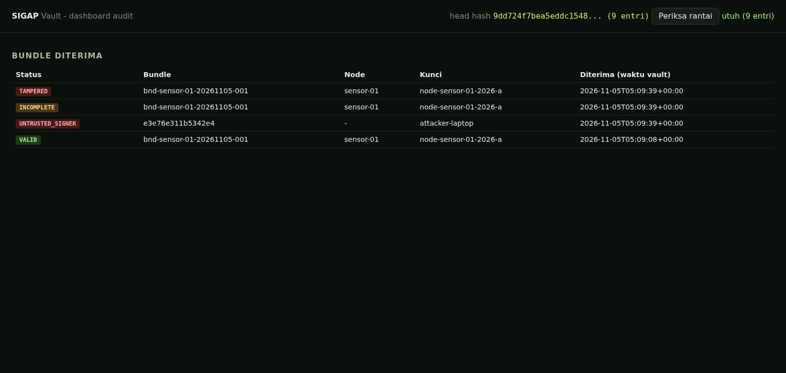

# SIGAP

**Sistem Integritas Gerak-cepat untuk Akuisisi Pembuktian.** Purwarupa forensik IoMT
(*Internet of Military Things*) yang offline-first untuk Kartika Cyber Hackathon 2026,
kategori Dukungan Teknologi (Digital Forensic Toolkit).

SIGAP mendeteksi perilaku mencurigakan di node, langsung mengumpulkan artefak ringan,
mengemasnya ke bundle dengan manifest bertanda tangan Ed25519, dan memverifikasinya
tanpa server pusat. Saat ada koneksi, bundle dikirim ke vault yang memverifikasi ulang
dan mencatat rantai kustodi berantai hash.

> **Yang dijamin:** perubahan, penambahan, atau penghapusan berkas setelah bundle
> ditandatangani terdeteksi oleh pemegang kunci publik tepercaya.
> **Yang tidak dijamin:** kebenaran isi artefak dari node yang sudah dikuasai penyerang.

## Untuk Juri

| | |
| --- | --- |
| Coba dalam 3 menit | `make up`, buka `http://127.0.0.1:8000`, lalu `make inject-reverse_shell` dan `make tamper-demo`. Panduan lengkap ada di [docs/cara_mencoba.md](docs/cara_mencoba.md) |
| Coba tanpa Docker (1 menit) | Unduh `sigap-kit-juri-*.zip` dari [halaman Releases](https://github.com/Daxxiee0x1/SIGAP/releases/latest), ekstrak, lalu klik dua kali `coba.cmd` (Windows) atau jalankan `./coba.sh` (macOS/Linux). Verifier memeriksa 1 bundle asli dan 9 bundle manipulasi tanpa memasang apa pun |
| Video demo | `[link YouTube, isi setelah diunggah]` |
| Slide penjelasan | [submission/SIGAP_Slides_Kartika_2026.pdf](submission/SIGAP_Slides_Kartika_2026.pdf) |
| Screenshot | [screenshot/](screenshot/) (5 gambar) |
| Thumbnail | [submission/thumbnail-1200x630.png](submission/thumbnail-1200x630.png) |
| Bukti hasil uji | [docs/bukti_demo.md](docs/bukti_demo.md) |
| HKI dan atribusi | [docs/HKI_DAN_ATRIBUSI.md](docs/HKI_DAN_ATRIBUSI.md) |



## Pembagian bahasa

| Komponen | Bahasa | Alasan |
| --- | --- | --- |
| `cmd/sigap`, `internal/*` (detektor, kolektor, penandatangan, pengemas, verifier, uplink) | **Go** (hanya stdlib) | Satu biner statis untuk amd64/arm64/armv7, tanpa runtime atau wheelhouse di node; memori kecil; `crypto/ed25519` dan `archive/zip` bawaan |
| `vault/` (API, log kustodi, dashboard) | **Python** (FastAPI + SQLite) | Cepat dibangun, mudah diaudit; verifikasi tetap memanggil biner Go yang sama |
| `simulation/`, `tools/`, `tests/` | **Python** | Skrip skenario, manipulasi bundle, dan uji end-to-end |

Hanya ada **satu implementasi verifikasi** (`internal/verify`). Node, laptop analis, dan
vault semuanya memanggilnya, sehingga hasil `VALID`/`TAMPERED` tidak bisa berbeda.

## Coba dalam 3 menit

Demo lengkap seperti di video (hanya butuh Docker + curl): `make demo`. Demo berhenti di
setiap adegan dan menunggu Enter. `AUTO=1 make demo` berjalan tanpa jeda.

```sh
make up                       # vault + sensor-01 + sink di jaringan Docker internal
open http://127.0.0.1:8000    # dashboard audit
make inject-reverse_shell     # skenario lain: egress, listen_port, config_change, cpu_spike, tmp_exec
make logs                     # ALERT -> bundle -> uplink -> verified
make tamper-demo              # verifikasi offline + 8 manipulasi, tanpa Go/Python di host
```

Tanpa Docker, cukup verifier: unduh kit juri dari [Releases](https://github.com/Daxxiee0x1/SIGAP/releases/latest) (biner
Windows, macOS, dan Linux beserta 10 contoh bundle), lalu jalankan `coba.cmd` atau
`./coba.sh`.

Tanpa Docker, dari kode sumber:

```sh
make build
./build/sigap keygen --key-id node-lab-a --out lab.key --trust trust_store.json
./build/sigap collect --config configs/agent.json        # sesuaikan path di config
./build/sigap verify --trust trust_store.json outbox/bnd-*.zip
```

## Status verifikasi

| Status | Arti | Exit |
| --- | --- | --- |
| `VALID` | Tanda tangan sah dari kunci di trust store, semua hash cocok | 0 |
| `TAMPERED` | Byte artefak/manifest/tanda tangan berubah, atau ada berkas tak terdaftar | 2 |
| `INCOMPLETE` | Berkas yang ada di manifest hilang dari zip | 3 |
| `UNTRUSTED_SIGNER` | `key_id` tidak ada, dicabut, atau kedaluwarsa di trust store | 4 |
| `MALFORMED` | Bukan zip, nama berbahaya (`../`, absolut, symlink), bom dekompresi | 5 |

## Struktur

```
cmd/sigap/            CLI tunggal: keygen | collect | agent | verify
internal/detector/    aturan: reverse shell, egress di luar allowlist, port baru, hash config, CPU/mem, exec dari /tmp
internal/collector/   baca /proc langsung (tanpa ps/ss/exec) + redaksi kredensial
internal/bundle/      manifest.json + manifest.sig terpisah + zip; sequence & prev hash
internal/signing/     Ed25519
internal/truststore/  kunci publik + masa berlaku + status
internal/verify/      verifier offline (input tak tepercaya)
internal/uplink/      store-and-forward ke vault (DDIL)
vault/                FastAPI + SQLite, log kustodi append-only berantai hash, dashboard tanpa CDN
simulation/           sensor simulasi + inject_anomaly.py (aman, jaringan internal)
tools/                make_tampered.py
tests/                pytest end-to-end + uji log kustodi
deploy/               Dockerfile agent & vault
offline/              kit instalasi tanpa internet
scripts/              demo.sh, build-release.sh, kit-juri/ (skrip coba dan panduan untuk Releases)
.github/workflows/    ci.yml (uji setiap push), release.yml (terbitkan Releases dari tag v*)
docs/                 arsitektur, model ancaman, cara mencoba, bukti demo, HKI
submission/           slide penjelasan (PDF) dan thumbnail 1200x630
screenshot/           5 tangkapan layar untuk form submission
```

## Dokumentasi

| Dokumen | Isi |
| --- | --- |
| [docs/cara_mencoba.md](docs/cara_mencoba.md) | Tiga jalur mencoba (Docker, tanpa Docker, verifier saja), hasil yang diharapkan, dan penanganan masalah |
| [docs/architecture.md](docs/architecture.md) | Arsitektur, kontrak Go dan Python, urutan pemeriksaan verifier |
| [docs/threat_model.md](docs/threat_model.md) | Ancaman yang ditangani dan yang di luar model |
| [docs/bukti_demo.md](docs/bukti_demo.md) | Keluaran asli satu run lengkap |
| [docs/HKI_DAN_ATRIBUSI.md](docs/HKI_DAN_ATRIBUSI.md) | Status hak cipta, atribusi pihak ketiga, dan deklarasi originalitas |

## Pengujian

```sh
pip install pytest -r vault/requirements.txt
make test   # go vet, go test, pytest (uji 1-8 rencana uji, kunci asing, redaksi, rantai kustodi)
```

## Batas klaim

- Bukan sistem produksi dan bukan pengganti Velociraptor/UAC/Autopsy.
- Timestamp di manifest dilaporkan sendiri oleh node; waktu tepercaya hanya `received_at` vault.
- Distribusi dan pencabutan kunci offline masih manual (menyalin `trust_store.json`).
- Hasil deteksi diukur pada skenario simulasi buatan tim, bukan klaim deteksi umum.
- Tidak mengklaim penerimaan bukti dalam proses hukum.

## Hak cipta dan atribusi

Hak cipta © 2026 Tim Pokoknya Ikut Aja Kata Dosen. Seluruh hak dilindungi. Penyelenggara Kartika Cyber Hackathon
2026 memperoleh lisensi non-eksklusif sesuai rulebook bagian N. Atribusi komponen pihak
ketiga dan deklarasi originalitas ada di [docs/HKI_DAN_ATRIBUSI.md](docs/HKI_DAN_ATRIBUSI.md).
